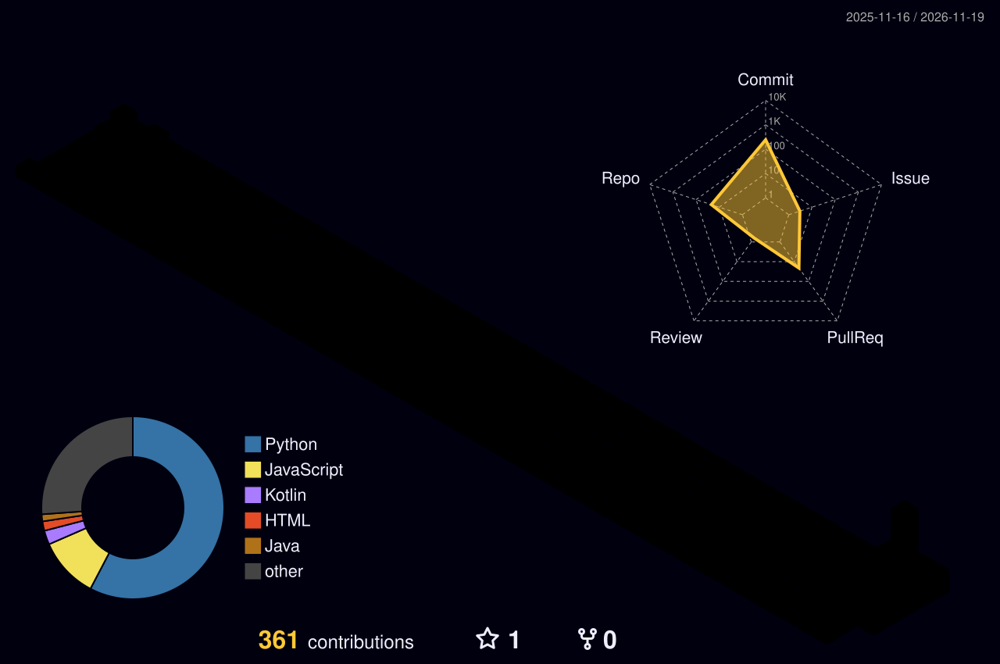

<!-- ========================================================================= -->
<!-- HERO SECTION (Clean Avatar, Typography & Dynamic Status)                  -->
<!-- ========================================================================= -->

  

  

  

<!-- ========================================================================= -->
<!-- 3D CONTRIBUTION ARCHITECTURE                                              -->
<!-- ========================================================================= -->

## The city I built this year

  <picture>
    <source media="(prefers-color-scheme: dark)" srcset="https://raw.githubusercontent.com/itsyunus/itsyunus/main/profile-3d-contrib/profile-night-rainbow.svg">
    <source media="(prefers-color-scheme: light)" srcset="https://raw.githubusercontent.com/itsyunus/itsyunus/main/profile-3d-contrib/profile-green-animate.svg">
    
  </picture>

Every building is a day; taller means more contributions.

<!-- ========================================================================= -->
<!-- CONTRIBUTION ACTIVITY                                                     -->
<!-- ========================================================================= -->

## Contribution activity

  

<!-- ========================================================================= -->
<!-- POPULATION & TELEMETRY (Unbranded Zero-Watermark Dark SVGs)                -->
<!-- ========================================================================= -->

## Population

  <table border="0" style="border-collapse: collapse;">
    <tr>
      <td align="center">
        
      </td>
      <td align="center">
        
      </td>
    </tr>
  </table>

  

  

<!-- LEETCODE-STREAK-START -->

Current LeetCode streak: <strong>11</strong> days

<!-- LEETCODE-STREAK-END -->

<!-- ========================================================================= -->
<!-- LANDMARKS / FEATURED PROJECTS                                             -->
<!-- ========================================================================= -->

## Landmarks

  <table border="0" style="border-collapse: collapse;">
    <tr>
      <td width="50%" align="center">
        
      </td>
      <td width="50%" align="center">
        
      </td>
    </tr>
  </table>

<!-- ========================================================================= -->
<!-- TIMELINE & CAREER                                                         -->
<!-- ========================================================================= -->

## The route here

  
  

<!-- ========================================================================= -->
<!-- VISIT & SOCIAL                                                            -->
<!-- ========================================================================= -->

## Visit

  
  
  

<a href="https://github.com/itsyunus">GitHub</a> · <a href="https://yunuz.codes/">Website</a>

Shaik Yunus · Engineered with zero bloat

