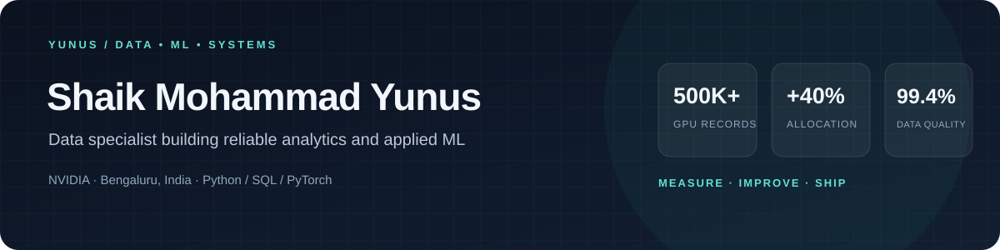

  

---

## 01 — WHO I AM

I build analytics that help teams make better decisions. My work spans **GPU telemetry and data quality at NVIDIA**, operational analytics, product engineering, and applied machine learning. I’m based in Bengaluru, India, and hold a B.Tech (Hons.) in Computer Science with a Data Science / ML focus and a DevOps minor.

## 02 — SYSTEM MAP

| 01 · SIGNALS | 02 · FOUNDATIONS | 03 · INSIGHT | 04 · APPLICATION |
| --- | --- | --- | --- |
| GPU telemetry Operational records Market news | Python · SQL ETL · validation Data modeling | Utilization trends KPI dashboards Root-cause analysis | Resource allocation Faster reporting ML research prototypes |

## 03 — SELECTED WORK

| PROJECT | BUILD NOTES |
| --- | --- |
| **Character-aware language model** PyTorch · NLP | Evaluated on the UD English Web Treebank. Character representations improved perplexity on unseen words by **3%** versus a same-size baseline. |
| **Transformer + sentiment analysis for trading** PyTorch · Flask · Go · React · AWS | Research prototype combining market signals and news sentiment, with REST APIs and R back-testing. |
| **Meraki policy management** React · Redux · Ruby on Rails | Built dashboard policy-management features during an internship; partnered with product and engineering to document and validate requirements. |

## 04 — TELEMETRY

<!-- LEETCODE-STREAK-START -->
🔥 Current LeetCode Streak: **7 days**
<!-- LEETCODE-STREAK-END -->

## 05 — THE ROUTE

| WHEN | ROLE | WORK |
| --- | --- | --- |
| **Oct 2026–Present** | Data Specialist · NVIDIA | Python/SQL analysis of **500K+ GPU records**; **10+ KPI dashboards**; automated validation reaching **99.4%** accuracy. |
| **Jun 2026–Present** | Data Analyst · Cautio | Analyzed **250K+ records**, cut manual reporting effort by **45%**, and built KPI dashboards. |
| **Mar–May 2026** | Business Analyst Intern · LaunchED Global | Product requirements, dashboard analytics, and React/Redux/Rails feature work. |
| **Jun–Aug 2024** | Software Engineering Intern · Board Infinity | C++, data structures, algorithms, and object-oriented programming. |

## 06 — STACK

**Data & analytics**  
    

**Machine learning & software**  
     

## 07 — RESEARCH & CREDENTIALS

- **Accepted for publication (2026):** “Design and Implementation of a Scalable Serverless Framework for Event-Driven Applications: Performance and Cost Efficiency Analysis,” *IJSREM*.
- **Submitted (2026):** “The Compute Horizon: Inference-Time Scaling and the Architecture of Reasoning AI,” *JCTSA*.
- Microsoft Certified: Azure AI Fundamentals (AI-900) · Oracle Certified Cloud Engineer

---

**CURRENTLY BUILDING** · Data quality, analytics infrastructure, and applied ML  
[Portfolio](https://www.yunuz.codes) · [LinkedIn](https://linkedin.com/in/shaikyunus01) · [Say hello](mailto:yunussm0@gmail.com)

